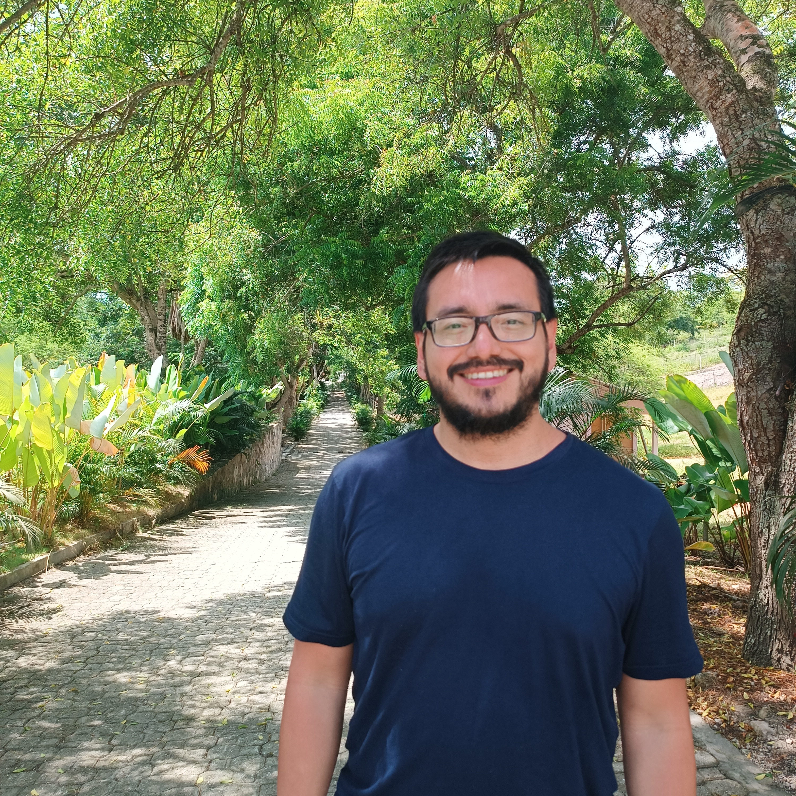

::: {.about-hero}

::: {.about-photo}

:::

::: {.about-text}

[[]{.pulse-dot} Montevideo, Uruguay]{.hero-eyebrow}

## David Escandón

[Data Engineer [·]{.sep} Analytics Engineer [·]{.sep} BI Developer]{.role}

I turn raw data into reliable systems and clear insights.
Based in Montevideo, Uruguay — working across the stack,
from ingestion pipelines to executive dashboards.

::: {.hero-actions}
[Projects →](projects/index.qmd){.btn .btn-primary}
[Experience](resume.qmd){.btn .btn-ghost}
[Contact](contact.qmd){.btn .btn-ghost}
:::

:::

:::
