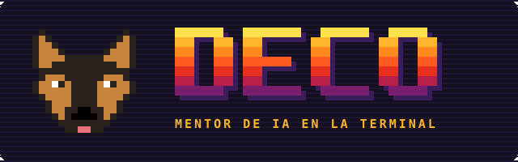

{fig-alt="Deco banner" width="100%"}

::: {.lang-en}

## Overview

**Deco** is my AI technical advisor in the terminal for **Analytics Engineering, Data
Engineering and AI Engineering** projects. It works like a senior peer: it reviews
architectures and data models, diagnoses problems, challenges design decisions and helps me
build to production standards, on both personal and professional projects.

It's also my tutor. It knows my projects, my skills and how they've been evolving: what I've
strengthened at work and in my own projects, and where I still have room to grow. From that it
builds study and practice plans, and it's designed to guide me into new areas such as data
governance or machine learning.

**How is it different from a regular chat? Its judgment rests on evidence, and the memory is
mine.** Deco doesn't answer "from memory": it cites sources from my brain, separates facts from
inferences and queries real data before recommending anything. That memory doesn't live with any
AI provider. It lives in a private repo of text files and in a DuckDB database built from them.
I can see, edit and version everything Deco "knows", and switch models without losing anything.

> The model is interchangeable (Claude, Groq, Ollama via LiteLLM). The asset is the memory
> and the rules for how it's read and written.

## What it does

**As a technical advisor**

- Reviews architecture, data models and design decisions while talking through my projects
- Diagnoses problems and trade-offs, using standards-based rubrics
- Compares a role's requirements against my skills and their evidence (`/jd`)

**As a tutor**

- `/learn <topic>`: step-by-step explanations, from basics to advanced, with questions and corrections
- `/mock <topic>`: technical interview practice with recorded scores
- `/roadmap [focus]`: a data-driven, prioritized plan (skill gap × industry relevance)
- `/checkin` and `/weekly`: progress tracking

## Architecture

:::

::: {.lang-es}

## Resumen

**Deco** es mi asesor técnico de IA en la terminal para proyectos de **Analytics Engineering,
Data Engineering y AI Engineering**. Funciona como un par senior: revisa arquitecturas y modelos
de datos, diagnostica problemas, cuestiona decisiones de diseño y me ayuda a construir con
estándares de producción, tanto en proyectos personales como profesionales.

También es mi tutor. Conoce mis proyectos, mis skills y cómo vienen evolucionando: qué fui
fortaleciendo en el trabajo y en proyectos propios, y dónde todavía tengo margen de mejora. Con
eso arma planes de estudio y práctica para seguir creciendo, y está pensado para acompañarme
hacia nuevas áreas, como gobernanza de datos o machine learning.

**¿La diferencia con un chat común? El criterio se apoya en evidencia, y la memoria es mía.**
Deco no responde "de memoria": cita las fuentes de mi brain, separa hechos de inferencias y
consulta datos reales antes de recomendar. Esa memoria no queda en ningún proveedor de IA: vive
en un repo privado con archivos de texto y en una DuckDB que se arma a partir de ellos. Puedo
ver, editar y versionar todo lo que Deco "sabe", y cambiar de modelo sin perder nada.

> El modelo es intercambiable (Claude, Groq, Ollama vía LiteLLM). El activo es la memoria
> y las reglas de cómo se lee y se escribe.

## Qué hace

**Como asesor técnico**

- Revisión de arquitectura, modelos de datos y decisiones de diseño, conversando sobre mis proyectos
- Diagnóstico de problemas y trade-offs, con criterio basado en estándares
- Análisis de perfiles técnicos: compara los requerimientos de un rol con mis skills y su evidencia (`/jd`)

**Como tutor**

- `/learn <tema>`: explicación por bloques, de lo básico a lo complejo, con preguntas y corrección
- `/mock <tema>`: sesión de preguntas técnicas con puntaje registrado
- `/roadmap [foco]`: plan priorizado con datos (brecha de skill × relevancia en la industria)
- `/checkin` y `/weekly`: seguimiento del avance

## Arquitectura

:::

```{mermaid}
flowchart LR
  U([Terminal]) --> CLI["deco CLI<br/>Typer + Rich"]
  CLI --> AG["Agent loop<br/>tool calling"]
  AG <-->|context + tools| LLM["LiteLLM<br/>Claude · Groq · Ollama"]
  AG --> TB[Toolbox]
  TB -->|read / search| BR[("deco-brain<br/>markdown + yaml")]
  TB -->|"propose_note_update<br/>diff + approval"| BR
  TB -->|append-only log| EV[("events/*.jsonl")]
  TB -->|read-only SQL| DB[("DuckDB<br/>marts")]
  BR --> BUILD[deco build-db]
  EV --> BUILD --> DB
  BR -->|git commit| GIT[("private git")]
```

::: {.lang-en}

## Key decisions

- **Memory lives outside the model.** The model is stateless and swappable; the memory is
  versioned text files in git plus a derived DuckDB, so I can change providers and audit every change.
- **Text is the source of truth.** Markdown, YAML and JSONL are canonical; DuckDB and indexes are
  rebuilt from them (`deco build-db`). Learning events are append-only, like a fact table.
- **Anti-hallucination by design.** Citations to brain files are mandatory, facts and inferences
  are labeled, a skill level only goes up with verifiable evidence, and SQL is read-only.
- **Human in the loop.** The model proposes memory changes as a diff; I approve them, and each
  one becomes a commit.
- **Public code, private memory.** The `deco` code is public; everything personal lives in a
  separate private repo.
- **Don't reinvent what exists.** Deco adds the domain layer (brain, standards, verification,
  evals) and will expose it as an MCP server, to be used from any client.

## Data model

`skills` · `events` · `projects` · `jobs` · `job_requirements` → marts such as
`mart_skill_gaps` (priority = level gap × relevance across analyzed roles),
`mart_unmapped_requirements` and `mart_weekly_activity`.

## Stack

Python · LiteLLM · Typer / Rich · DuckDB · GitHub Actions

## Status & roadmap

In active development (started November 2026). Next up: response streaming and cost
observability, a model router, migrating the data layer to **dbt-duckdb** with tests and
lineage, and hybrid search with embeddings and evals in CI.

:::

::: {.lang-es}

## Decisiones clave

- **La memoria vive fuera del modelo.** El modelo es intercambiable y sin estado; la memoria son
  archivos de texto versionados en git más una DuckDB derivada, así puedo cambiar de proveedor y
  auditar cada cambio.
- **El texto es la fuente de verdad.** Markdown, YAML y JSONL son la verdad; DuckDB e índices se
  reconstruyen (`deco build-db`). Los eventos de aprendizaje son append-only, como una tabla de hechos.
- **Anti-alucinación por diseño.** Citas obligatorias a archivos del brain, hechos e inferencias
  marcados, un nivel de skill solo sube con evidencia verificable y el SQL es de solo lectura.
- **Human-in-the-loop.** El modelo propone cambios a la memoria como diff; yo apruebo y queda un commit.
- **Código público, memoria privada.** El código de `deco` es público; todo lo personal vive en
  un repo privado separado.
- **No reinventar lo que ya existe.** Deco aporta la capa de dominio (brain, standards,
  verificación, evals) y la va a exponer como servidor MCP para usarla desde cualquier cliente.

## Modelo de datos

`skills` · `events` · `projects` · `jobs` · `job_requirements` → marts como
`mart_skill_gaps` (prioridad = brecha de nivel × relevancia en los roles analizados),
`mart_unmapped_requirements` y `mart_weekly_activity`.

## Stack

Python · LiteLLM · Typer / Rich · DuckDB · GitHub Actions

## Estado y roadmap

En desarrollo activo (desde noviembre de 2026). Próximos pasos: streaming de respuestas y
observabilidad de costos, router de modelos, migración de la capa de datos a **dbt-duckdb** con
tests y linaje, y búsqueda híbrida con embeddings y evals en CI.

:::

[GitHub Repo](https://github.com/descandon88/deco){.btn .btn-primary}
